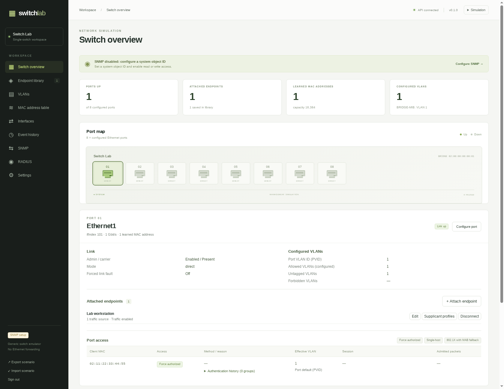

# Switch Lab

An SNMP switch simulator with a web UI for ports, endpoints, VLANs, MAC learning, and RADIUS access. It simulates switch management state without forwarding Ethernet frames.



## Run with Docker

From this directory:

```sh
docker compose up --build -d
```

Open **http://localhost:8000** and create the administrator password; there are no default credentials. Then open **SNMP** and choose **Set up SNMP**: enter the system object ID and a read-only community, and Switch Lab enables and saves SNMP in one step. The system object ID is a full numeric OID under a Private Enterprise Number your organization has registered with IANA. Managers can then query the host on UDP 161.

On first start the container creates the encryption key for saved settings in the `switchlab-key` volume, apart from the `switchlab-data` volume that holds the lab and saved configuration. Back up both: saved settings can only be read with their key.

Compose publishes HTTP TCP 8000, SNMP UDP 161, and CoA/Disconnect UDP 3799 on localhost. To change that, copy [`.env.example`](.env.example) to `.env` and run `docker compose up -d` again. It covers:

- **LAN access:** `SWITCHLAB_BIND_ADDRESS` set to an IPv4 address of this host, then open `http://HOST_LAN_ADDRESS:8000` from another device. Connectivity depends on the host firewall and routing. HTTP is unencrypted; HTTPS can be provided by a reverse proxy.
- **Host ports:** `SWITCHLAB_HTTP_PORT`, `SWITCHLAB_SNMP_PORT` (for example 1161 when the host cannot publish 161) and `SWITCHLAB_COA_PORT`. Inside the container Switch Lab always listens on 8000, 161 and 3799, so nothing in the UI has to match.
- **Starting after a reboot:** `SWITCHLAB_RESTART=unless-stopped`. By default Switch Lab runs only when you start it (`docker compose up -d`) and stops with `docker compose stop`.

An administrator can optionally enable a shared read-only viewer under **Settings → Manage viewer access**; it starts disabled. See [management access](specification/docs/MANAGEMENT.md). Physical lab edits persist automatically. Switch settings apply to the running configuration; the page header shows **Unsaved changes** until you choose **Save configuration**, which keeps them across reboot or restart.

For SNMPv3, write access, views and trap destinations, use the detailed sections on the **SNMP** page and the [identity and listener setup guide](specification/docs/IDENTITY_SETUP.md). CoA/Disconnect starts disabled; configure and save its listener and trusted clients using the [RADIUS setup guide](specification/docs/RADIUS.md#coa-and-disconnect).

### Upgrading from a version with `secrets/config.key`

Earlier versions kept the key in `secrets/config.key` beside `compose.yaml`. Copy it into the key volume once, before starting the new version:

```sh
docker compose run --rm --no-deps -v "$PWD/secrets/config.key:/old.key:ro" --entrypoint cp switchlab /old.key /key/config.key
```

Without it, a container with saved data stops at start with a message naming the missing key. Earlier versions also listened on the SNMP and CoA ports set in the UI; the container now always listens on 161 and 3799, and `.env` alone chooses the host ports.

### Native alternative

Python 3.12+ is required. The compiled UI is included. Activate the virtual environment for your shell, then run one application worker:

```sh
python -m venv .venv
# Windows: .venv\Scripts\activate
# Linux/macOS: . .venv/bin/activate
python -m pip install .
python -m uvicorn switchlab.api:app --host 127.0.0.1 --port 8000 --workers 1
```

For native LAN access, use the host's LAN address with `--host`. Natively, the SNMP and CoA listeners use the ports set in the UI. EAP-TLS and PEAP require the managed Linux helper included in Docker; Python-only native installs support MAB. See the [RADIUS setup guide](specification/docs/RADIUS.md). Native data and key paths default to `data/switch.db` and `secrets/config.key`; the key is created on first start, and both are required to restore saved configuration.

## Documentation

- [Setup and identity](specification/docs/IDENTITY_SETUP.md)
- [RADIUS access, accounting, and dynamic authorization](specification/docs/RADIUS.md)
- [Local management accounts and permissions](specification/docs/MANAGEMENT.md)
- [API schema](docs/openapi.json); interactive documentation is at `/docs` on the running instance.
- [Technical specification](specification/TECHNICAL_SPECIFICATION.md) and [supported MIB objects](specification/docs/mib-coverage.csv)
- [Formal models and how to check them](specification/README.md)

## Testing

The test images hold everything the checks need. Run them from this directory:

```sh
docker build --target test -t switchlab-test .
docker run --rm --cap-drop ALL --security-opt no-new-privileges --sysctl net.ipv4.ip_unprivileged_port_start=161 switchlab-test
docker build --target browser-test -t switchlab-browser-test .
docker run --rm --network none --cap-drop ALL --security-opt no-new-privileges switchlab-browser-test
```

The first pair runs the Python suite, including real SNMP and RADIUS exchanges over loopback. The second drives the packaged UI in Chromium. [`.github/workflows/test.yml`](.github/workflows/test.yml) runs both, plus a clean-runtime release check and an isolated LAN check.

## License

Original code, documentation, models, and project assets use the [MIT License](LICENSE). Dependencies retain their upstream licenses. Native EAP inputs and notices are in `runtime/eap/` and ship in Docker at `/usr/local/share/doc/eapol_test`. [Third-party notices](ui/public/assets/THIRD_PARTY_NOTICES.txt) also ship with the packaged UI at `/assets/THIRD_PARTY_NOTICES.txt`.
